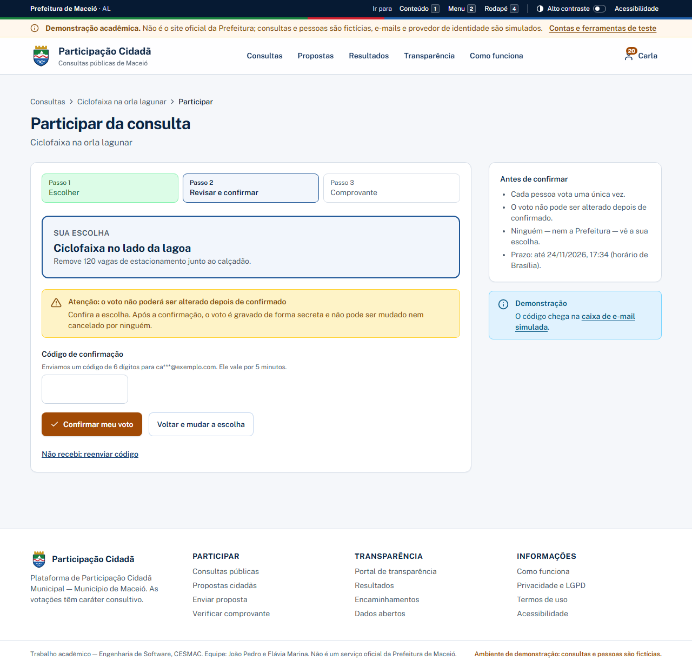

# PPCM — Plataforma de Participação Cidadã Municipal

Portal web que aproxima a população da administração municipal: o cidadão conhece as consultas públicas, vota de forma **consultiva, única e secreta**, recebe comprovante, envia propostas e acompanha resultados e encaminhamentos. Trabalho acadêmico de Engenharia de Software — CESMAC.

> **Demonstração acadêmica.** Município, pessoas e dados são fictícios. O provedor de identidade (gov.br) e o SMS são **simulados**; não há integração oficial.


## Objetivo
Implementar integralmente o [Documento de Requisitos v6](docs/Documento_de_Requisitos_v6.pdf): 68 requisitos funcionais, 15 não funcionais e 13 de segurança, com rastreabilidade entre requisito, código e teste.

## Funcionalidades
- **Cidadão:** cadastro com validação de CPF, confirmação de e-mail, verificação de identidade, votação em 3 passos com código de confirmação, comprovante verificável, propostas com protocolo, central de avisos, cópia dos dados e desativação (LGPD).
- **Portal público:** consultas com busca e filtros, histórico, resultados com gráfico e tabela, encaminhamentos, acervo, indicadores e dados abertos (CSV, JSON, PDF).
- **Administração:** ciclo completo da consulta (elaboração, revisão, aprovação, prazo excepcional, publicação, alteração, suspensão, cancelamento), abertura/encerramento/apuração automáticos, homologação e retificação, monitoramento sem parciais, relatórios, usuários, papéis, propostas, moderação, auditoria e incidentes.
- **Segurança:** voto sem vínculo com o eleitor, voto único garantido pelo banco, Argon2id, segundo fator (TOTP) para servidores, segregação de funções, auditoria encadeada por hash, registros imutáveis por gatilhos, CSP com nonce.

| Votação | Resultado | Administração |
|---|---|---|
|  |  |  |

Mais capturas em [`screenshots/`](screenshots/).

## Tecnologias
Next.js 15 (App Router) · React 19 · TypeScript · Tailwind CSS 4 · PostgreSQL (PGlite em desenvolvimento) · Drizzle ORM · Zod · Vitest · Playwright + axe-core.

## Como executar

Requisitos: Node.js 20.11+ (testado no 24). Não é preciso instalar banco para desenvolver.

```bash
npm install
npm run dev          # http://localhost:3000
```

Na primeira execução o sistema aplica as migrations e carrega os dados fictícios num banco local (`.data/pglite`). Para recomeçar: `npm run db:reset`.

**Contas de demonstração** (lista completa e códigos do segundo fator em `http://localhost:3000/demo`): senha `Demo@2026` para todas.

| Conta | Perfil |
|---|---|
| `maria@exemplo.com` | Cidadã verificada |
| `joao@exemplo.com` | Cidadão sem identidade verificada |
| `gestor@prefeitura.exemplo` | Gestor de acessos |
| `elaboradora@`, `revisor@`, `aprovadora@`, `responsavel@`, `analista@prefeitura.exemplo` | Papéis administrativos |

Os e-mails (confirmação, códigos de voto, comprovantes) aparecem em `/demo/caixa-de-email`.

### Configuração
Copie `.env.example` para `.env`. Sem `.env` o sistema roda em modo demonstração com chaves inseguras de teste. Para produção defina `DATABASE_URL`, `CPF_HMAC_KEY`, `DATA_ENCRYPTION_KEY`, `APP_SIGNING_KEY`, `APP_URL` (https), `DEMO_MODE=false` e `SMTP_URL`. **Nunca versione o `.env`.**

### PostgreSQL com Docker
```bash
cp .env.example .env   # preencha os segredos e POSTGRES_PASSWORD
docker compose up --build
```
(Arquivos preparados; não foram executados no ambiente de desenvolvimento, que não tinha Docker.)

## Testes
```bash
npm run check        # tipos + lint + 97 testes unitários e de integração
npm run test:e2e     # 32 testes E2E em build de produção, com acessibilidade (axe)
npm run screenshots  # regenera as capturas das telas
```
Resultados, cenários e limites em [docs/PLANO_DE_TESTES.md](docs/PLANO_DE_TESTES.md).

## Estrutura
```
src/app            rotas: (site) portal e cidadão, admin, api
src/components     componentes de interface
src/server/actions Server Actions
src/server/modules regras de negócio por módulo
src/server/lib     criptografia, arquivos, parâmetros, relógio
src/server/db      schema, cliente, dados fictícios
drizzle/           migrations SQL
tests/             unit, integration, e2e, screenshots
docs/              requisitos, arquitetura, riscos, rastreabilidade, status
```

## Documentação
[AGENTS.md](AGENTS.md) · [Status](docs/STATUS_DO_DESENVOLVIMENTO.md) · [Requisitos completos](docs/REQUISITOS_COMPLETOS.md) · [Mapeamento](docs/MAPEAMENTO_DE_REQUISITOS.md) · [Arquitetura](docs/ARQUITETURA.md) · [Modelo de dados](docs/MODELO_DE_DADOS.md) · [Decisões técnicas](docs/DECISOES_TECNICAS.md) · [Riscos](docs/MATRIZ_DE_RISCOS.md) · [Rastreabilidade](docs/MATRIZ_DE_RASTREABILIDADE.md) · [Pendências com o cliente](docs/PENDENCIAS_CLIENTE.md) · [Plano Trello](docs/PLANO_TRELLO.md)

## Limites conhecidos
Integração gov.br e SMS simulados; recursos condicionados (comentários, apoios, eventos) desligados até validação; desempenho, disponibilidade, leitores de tela e restauração de backup ainda não medidos. Não usar em produção sem teste de intrusão e relatório de impacto à proteção de dados.

## Equipe
João Pedro e Flávia Marina — Engenharia de Software, CESMAC.
