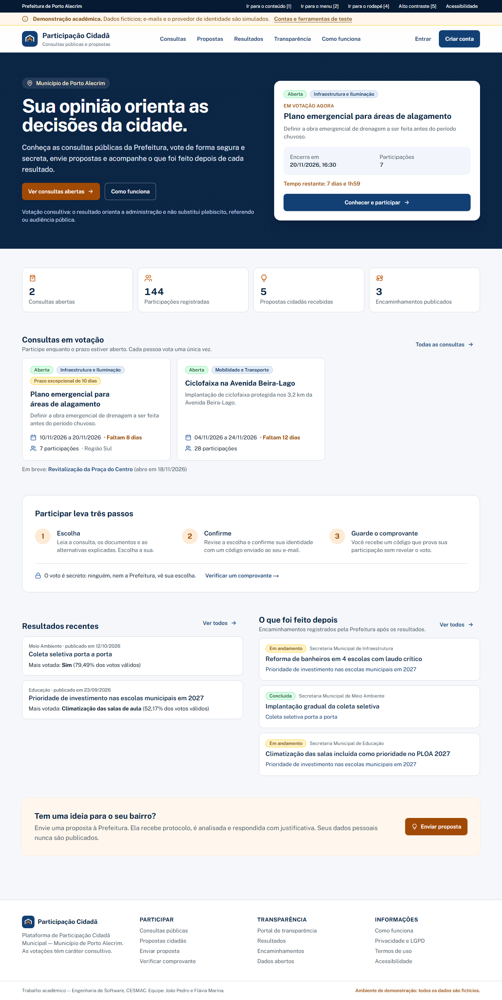
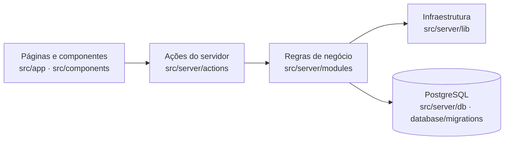
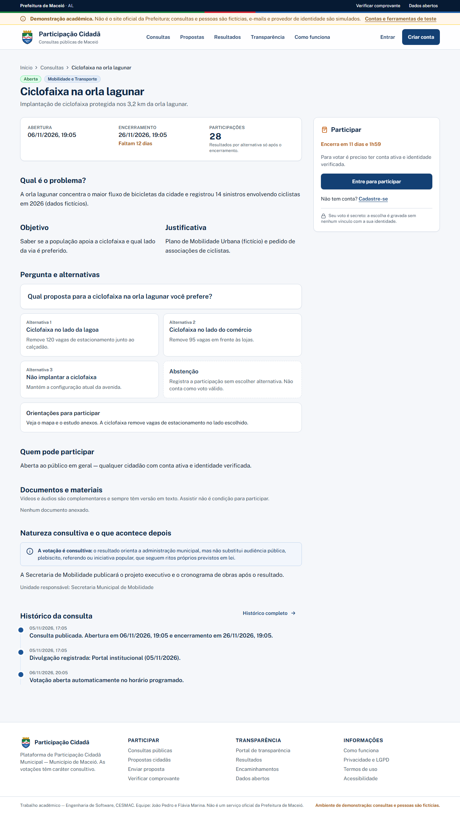
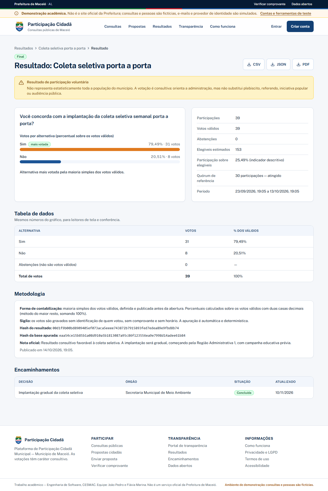
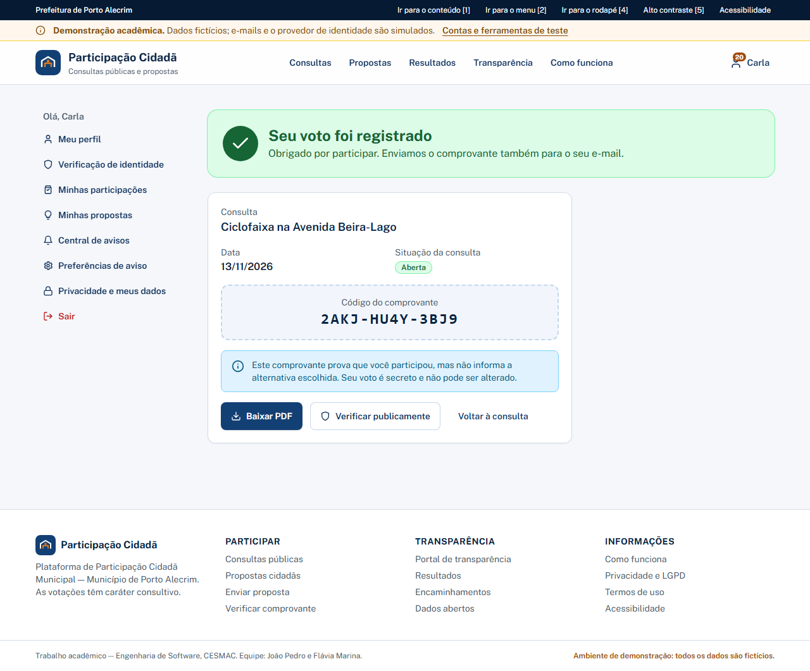
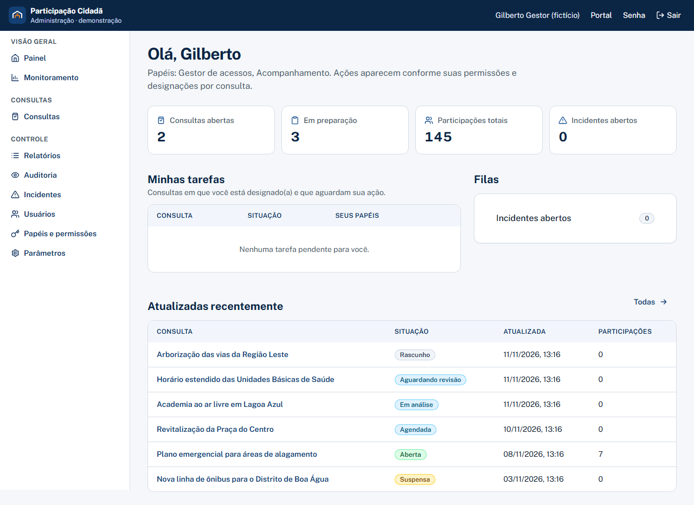
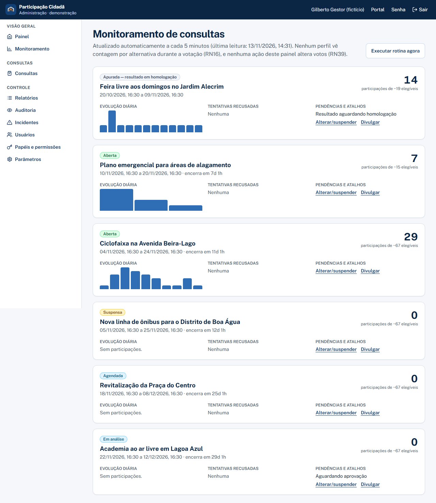

# PPCM — Plataforma de Participação Cidadã Municipal

Projeto acadêmico da disciplina de Engenharia de Software — **CESMAC**.

[](https://github.com/Pedro-prog777/plataforma-participacao-cidada-municipal/actions/workflows/ci.yml)

| | |
|---|---|
| **Integrantes** | João Pedro e Flávia Marina |
| **Instituição** | CESMAC |
| **Curso** | Engenharia de Software |
| **Repositório** | <https://github.com/Pedro-prog777/plataforma-participacao-cidada-municipal> |
| **Quadro Trello** | <https://trello.com/b/AQX3bDST> (público) |
| **Documento-base** | [Documento de Requisitos v6 (PDF)](docs/requisitos/Documento_de_Requisitos_v6.pdf) |

> **Demonstração acadêmica.** O município, as pessoas e todos os dados são fictícios. O login gov.br e o envio de SMS são **simulados** e identificados como tal; não existe integração oficial.



## Sumário

1. [Descrição da plataforma](#1-descrição-da-plataforma)
2. [Objetivo geral](#2-objetivo-geral)
3. [Tecnologias utilizadas](#3-tecnologias-utilizadas)
4. [Arquitetura do sistema](#4-arquitetura-do-sistema)
5. [Funcionalidades desenvolvidas](#5-funcionalidades-desenvolvidas)
6. [Requisitos atendidos](#6-requisitos-atendidos)
7. [Estrutura das pastas](#7-estrutura-das-pastas)
8. [Como instalar e executar](#8-como-instalar-e-executar)
9. [Como executar os testes](#9-como-executar-os-testes)
10. [Evidências visuais das telas](#10-evidências-visuais-das-telas)
11. [Acompanhamento do Desenvolvimento](#acompanhamento-do-desenvolvimento)
12. [Documentação](#documentação)

## 1. Descrição da plataforma

A PPCM é um portal web que aproxima a população da administração municipal. Pela plataforma, o cidadão conhece as consultas públicas abertas pela Prefeitura, entende o assunto em discussão, registra a sua opinião por votação, envia propostas e acompanha os resultados e o que foi feito depois de cada consulta (encaminhamentos).

A votação tem **caráter consultivo**: o resultado orienta a administração, mas não substitui audiência pública, plebiscito ou referendo. Cada cidadão vota **uma única vez** por consulta, o voto é **secreto** (nem a administração consegue saber quem escolheu o quê) e o cidadão recebe um **comprovante** que prova a participação sem revelar a escolha.

## 2. Objetivo geral

Implementar integralmente o Documento de Requisitos v6 — 68 requisitos funcionais (RF001–RF068), 15 não funcionais (RNF01–RNF15) e 13 de segurança (RS001–RS013) — com rastreabilidade entre requisito, código, tela e teste, e com atenção especial ao sigilo do voto, à proteção de dados pessoais (LGPD) e à acessibilidade.

## 3. Tecnologias utilizadas

| Camada | Tecnologia |
|---|---|
| Interface | Next.js 15 (App Router), React 19, TypeScript, Tailwind CSS 4 |
| Servidor | Server Actions e Route Handlers do Next.js, validação com Zod |
| Banco de dados | PostgreSQL 16 com Drizzle ORM (no desenvolvimento, PGlite — PostgreSQL embutido, sem instalação) |
| Segurança | Argon2id (senhas), TOTP (segundo fator), AES-256-GCM, HMAC-SHA256, CSP com nonce |
| Testes | Vitest (unitários, integração e segurança), Playwright (ponta a ponta), axe-core (acessibilidade) |
| Entrega | GitHub Actions (integração contínua), Docker e Docker Compose |

## 4. Arquitetura do sistema

Aplicação única (monólito) em Next.js, organizada em camadas com dependência em um só sentido:



- **Regras de negócio em um só lugar** (`src/server/modules`): cada serviço valida os dados no servidor, confere a permissão, executa em transação e registra na auditoria.
- **Sigilo do voto por estrutura:** a tabela de participações guarda quem votou em qual consulta (só a data); a tabela de votos guarda a alternativa, sem nenhum identificador do cidadão, do comprovante ou do horário. As duas são gravadas na mesma transação e não têm relacionamento entre si.
- **Voto único garantido pelo banco:** restrição de unicidade do par cidadão–consulta, além da verificação na tela e na regra.
- **Registros imutáveis:** votos, participações, auditoria e resultados só aceitam acréscimo (gatilhos no banco); a auditoria é encadeada por hash.
- **Separação de funções:** quem elabora ou revisa uma consulta não a aprova; contas administrativas não votam e exigem segundo fator.

Detalhes em [ARQUITETURA.md](docs/arquitetura/ARQUITETURA.md), [MODELO_DE_DADOS.md](docs/arquitetura/MODELO_DE_DADOS.md) e [DECISOES_TECNICAS.md](docs/arquitetura/DECISOES_TECNICAS.md).

## 5. Funcionalidades desenvolvidas

**Portal público (sem login)**
- Lista, busca e filtros de consultas; página de cada consulta com período, público-alvo, documentos e histórico.
- Resultados com gráfico e tabela, encaminhamentos, acervo de consultas encerradas e indicadores.
- Dados abertos em CSV, JSON e PDF; verificação pública de comprovante; página "Como funciona".

**Área do cidadão**
- Cadastro com validação de CPF e pontuação automática (CPF, data, celular e CEP), confirmação de e-mail, recuperação e troca de senha.
- Verificação de identidade (provedor simulado ou análise de documentos).
- Votação em 3 passos com código de confirmação e comprovante.
- Envio e acompanhamento de propostas, central de avisos e preferências de notificação.
- Direitos da LGPD: cópia dos dados e desativação da conta com anonimização.

**Administração da Prefeitura**
- Ciclo completo da consulta: proposta, elaboração, alternativas, público-alvo, responsáveis, revisão, aprovação, prazo excepcional, publicação, alteração, suspensão e cancelamento.
- Abertura, encerramento e apuração automáticos; homologação e retificação do resultado; encaminhamentos.
- Monitoramento sem resultados parciais, relatórios agregados, divulgação com QR Code.
- Usuários, papéis e permissões, parâmetros do sistema, análise de propostas, moderação, auditoria e incidentes.

## 6. Requisitos atendidos

| Grupo | Situação |
|---|---|
| Requisitos funcionais (68) | **68 implementados**, todos com teste automatizado. RF064 (comentários), RF067 (apoios) e RF068 (eventos) estão prontos, mas **desligados por padrão**, porque o documento os marca como dependentes de aprovação do cliente (\*). RF004, RF005 e RF011 usam provedor de identidade e SMS **simulados**. |
| Requisitos não funcionais (15) | 6 testados (RNF02, 03, 07, 08, 12, 13); 3 testados em parte (RNF01, 05, 14); 3 implementados sem medição (RNF04, 06, 15); 3 pendentes de medição (RNF09, 10, 11). |
| Requisitos de segurança (13) | Controles implementados para RS001–RS013. Não houve teste de intrusão independente — ver [limites](docs/testes/PLANO_DE_TESTES.md). |

A situação de cada requisito, com tela, módulo e teste, está em [MAPEAMENTO_DE_REQUISITOS.md](docs/requisitos/MAPEAMENTO_DE_REQUISITOS.md) e [STATUS_DO_DESENVOLVIMENTO.md](docs/STATUS_DO_DESENVOLVIMENTO.md).

## 7. Estrutura das pastas

```text
plataforma-participacao-cidada-municipal/
├── AGENTS.md                  Regras do projeto e requisitos completos
├── README.md
├── .env.example               Modelo de configuração (sem segredos)
├── docs/
│   ├── STATUS_DO_DESENVOLVIMENTO.md
│   ├── requisitos/            PDF original, transcrição, mapeamento, rastreabilidade, pendências
│   ├── arquitetura/           Arquitetura, modelo de dados, decisões técnicas
│   ├── seguranca/             Matriz de riscos
│   ├── testes/                Plano de testes e resultados
│   └── trello/                Plano do quadro e cartões para importação
├── src/
│   ├── app/                   Interface: rotas e páginas (portal, cidadão, admin, api)
│   ├── components/            Interface: componentes reutilizáveis
│   ├── lib/                   Código compartilhado (CPF, textos, rótulos)
│   └── server/                Servidor
│       ├── actions/           Ações chamadas pelos formulários
│       ├── auth/              Sessão e guardas de acesso
│       ├── modules/           Regras de negócio por módulo
│       ├── lib/               Criptografia, arquivos, parâmetros, relógio
│       └── db/                Schema, conexão e migração
├── database/
│   ├── migrations/            SQL das tabelas e dos gatilhos de imutabilidade
│   ├── seeds/                 Dados de referência e dados fictícios de demonstração
│   └── diagrams/              Diagrama entidade-relacionamento
├── tests/
│   ├── unit/                  Regras isoladas
│   ├── integration/           Serviços com banco real
│   ├── security/              Entradas maliciosas e SSRF
│   ├── e2e/                   Navegador (Playwright) com acessibilidade
│   └── screenshots/           Roteiro que gera as capturas
├── screenshots/
│   ├── area-publica/  cidadao/  administrador/  celular/
├── scripts/                   Banco, rotina automática e servidor de testes
└── .github/workflows/         Integração contínua
```

O modelo de entrega sugeria pastas `frontend/` e `backend/` separadas. Como o Next.js compila interface e servidor no mesmo projeto, a separação foi feita por camadas dentro de `src/` (decisão DT-18).

## 8. Como instalar e executar

Requisito: **Node.js 20.11 ou superior**. Não é preciso instalar banco de dados.

```bash
git clone https://github.com/Pedro-prog777/plataforma-participacao-cidada-municipal.git
cd plataforma-participacao-cidada-municipal
npm install
npm run dev
```

Abra <http://localhost:3000>. Na primeira execução o sistema cria o banco local, aplica as migrations e carrega os dados fictícios. Para recomeçar do zero: `npm run db:reset`.

**Contas de demonstração** — senha `Demo@2026` para todas (são contas fictícias, criadas só no modo demonstração). A lista completa e os códigos do segundo fator ficam em <http://localhost:3000/demo>.

| Conta | Perfil |
|---|---|
| `maria@exemplo.com` | Cidadã com identidade verificada |
| `joao@exemplo.com` | Cidadão sem identidade verificada |
| `carla@exemplo.com` | Cidadã verificada que ainda não votou |
| `gestor@prefeitura.exemplo` | Gestor de acessos |
| `elaboradora@`, `revisor@`, `aprovadora@`, `responsavel@`, `analista@prefeitura.exemplo` | Demais papéis administrativos |

Os e-mails enviados pelo sistema (confirmação, código de voto, comprovante) aparecem em `/demo/caixa-de-email`.

**Configuração.** Sem arquivo `.env` o sistema roda em modo demonstração, com chaves de teste. Para outro ambiente, copie `.env.example` para `.env` e defina `DATABASE_URL`, `CPF_HMAC_KEY`, `DATA_ENCRYPTION_KEY`, `APP_SIGNING_KEY`, `APP_URL`, `DEMO_MODE=false` e `SMTP_URL`. O `.env` nunca vai para o repositório.

**Com Docker e PostgreSQL** (arquivos preparados; não foram executados no ambiente de desenvolvimento, que não tinha Docker):

```bash
cp .env.example .env   # preencha os segredos e POSTGRES_PASSWORD
docker compose up --build
```

## 9. Como executar os testes

```bash
npm run check        # tipos + lint + testes unitários, de integração e de segurança
npm run test:e2e     # testes no navegador, em build de produção, com acessibilidade
npm run screenshots  # regenera as capturas das telas
```

Última execução (13/11/2026, Windows 11, Node 24):

| Verificação | Resultado |
|---|---|
| Tipos (TypeScript) | sem erros |
| Lint (ESLint) | sem erros |
| Unitários, integração e segurança (Vitest, 9 arquivos) | **122 de 122 aprovados** |
| Ponta a ponta com acessibilidade (Playwright, Chromium) | **33 de 33 aprovados** |
| Dependências (`npm audit --omit=dev`) | 0 vulnerabilidades |
| Integração contínua (GitHub Actions, Ubuntu, Node 22, **PostgreSQL 16 real**) | **aprovada** a cada envio — [execuções](https://github.com/Pedro-prog777/plataforma-participacao-cidada-municipal/actions) |

Cenários, cobertura por requisito e o que **não** foi testado (carga, leitores de tela, outros navegadores, teste de intrusão) estão em [PLANO_DE_TESTES.md](docs/testes/PLANO_DE_TESTES.md).

## 10. Evidências visuais das telas

Capturas reais das telas implementadas, geradas automaticamente a partir do sistema em execução (`npm run screenshots`). Não houve protótipo separado em ferramenta de design: as telas foram construídas diretamente no sistema.

| Consulta pública | Resultado |
|---|---|
|  |  |

| Votação — revisar a escolha | Voto registrado e comprovante |
|---|---|
|  |  |

| Painel da administração | Monitoramento sem parciais |
|---|---|
|  |  |

Todas as capturas: [área pública](screenshots/area-publica/) · [cidadão](screenshots/cidadao/) · [administrador](screenshots/administrador/) · [celular](screenshots/celular/).

## Acompanhamento do Desenvolvimento

| Item | Situação |
|---|---|
| **GitHub** | <https://github.com/Pedro-prog777/plataforma-participacao-cidada-municipal> — código, documentação, testes e capturas; histórico de commits por etapa |
| **Trello** | <https://trello.com/b/AQX3bDST> — quadro público com 10 listas e 41 cartões: documentação, requisitos, telas (57 capturas anexadas), o que falta fazer, segurança, testes, módulos concluídos e pendências de validação. A definição do quadro fica em [docs/trello/](docs/trello/). |
| **Situação atual** | Sistema completo e navegável em modo demonstração; os 68 requisitos funcionais implementados e testados |
| **Detalhe por requisito** | [docs/STATUS_DO_DESENVOLVIMENTO.md](docs/STATUS_DO_DESENVOLVIMENTO.md) |

**Funcionalidades concluídas**
- Cadastro, autenticação, segundo fator, recuperação de senha e controle de acesso por papel.
- Ciclo completo da consulta pública, com separação de funções e rotina automática.
- Votação secreta e única, comprovante, verificação de integridade, apuração e publicação de resultados.
- Propostas cidadãs, denúncia e moderação, notificações, encaminhamentos.
- Portal de transparência, dados abertos, relatórios, auditoria e incidentes.
- Verificação diária de links externos e proteções contra entradas maliciosas.

**Funcionalidades pendentes ou limitadas**
- Integração oficial com o gov.br e provedor de SMS (hoje simulados; dependem de credenciamento).
- Decisões do cliente sobre os itens marcados com (\*) no documento — lista em [PENDENCIAS_CLIENTE.md](docs/requisitos/PENDENCIAS_CLIENTE.md). Comentários, apoios e eventos ficam desligados até lá.
- Medição de desempenho e disponibilidade (RNF09, RNF10) e teste em outros navegadores e com leitores de tela (RNF01, RNF11).
- Execução com Docker e restauração de backup (preparados, não exercitados).
- Teste de intrusão independente e relatório de impacto à proteção de dados (RNF06). **O sistema não deve ser usado em produção sem essas etapas.**

## Documentação

| Assunto | Documento |
|---|---|
| Regras do projeto e requisitos completos | [AGENTS.md](AGENTS.md) |
| Requisitos | [Documento original (PDF)](docs/requisitos/Documento_de_Requisitos_v6.pdf) · [Transcrição](docs/requisitos/REQUISITOS_COMPLETOS.md) · [Mapeamento requisito → código → teste](docs/requisitos/MAPEAMENTO_DE_REQUISITOS.md) · [Rastreabilidade](docs/requisitos/MATRIZ_DE_RASTREABILIDADE.md) · [Pendências com o cliente](docs/requisitos/PENDENCIAS_CLIENTE.md) |
| Arquitetura | [Arquitetura](docs/arquitetura/ARQUITETURA.md) · [Modelo de dados](docs/arquitetura/MODELO_DE_DADOS.md) · [Diagrama ER](database/diagrams/modelo-er.md) · [Decisões técnicas](docs/arquitetura/DECISOES_TECNICAS.md) |
| Segurança | [Matriz de riscos](docs/seguranca/MATRIZ_DE_RISCOS.md) |
| Testes | [Plano de testes e resultados](docs/testes/PLANO_DE_TESTES.md) |
| Acompanhamento | [Status do desenvolvimento](docs/STATUS_DO_DESENVOLVIMENTO.md) · [Plano do Trello](docs/trello/PLANO_TRELLO.md) |
