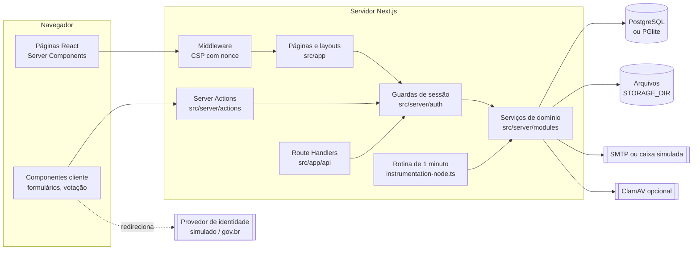

# Arquitetura — PPCM

## Visão geral



## Camadas

| Camada | Pasta | Responsabilidade |
|---|---|---|
| Interface | `src/app`, `src/components` | Páginas (Server Components), formulários cliente, layout e acessibilidade. Não acessa o banco. |
| Ações | `src/server/actions` | Recebem `FormData`, chamam o guarda de sessão e o serviço, convertem erros de domínio em mensagens por campo e redirecionam. |
| Guardas | `src/server/auth/current.ts` | Sessão atual, `requireCitizen`, `requireAdmin(permissão)`; auditam acessos negados. |
| Domínio | `src/server/modules/*` | Regras de negócio, validação (Zod), autorização (permissão + papel na consulta), transações e auditoria. Testáveis sem o Next.js. |
| Infraestrutura | `src/server/lib`, `src/server/db` | Banco, criptografia, CPF, Argon2id, TOTP, arquivos, CSV/PDF, CAPTCHA, parâmetros, relógio do servidor. |
| Compartilhado | `src/lib` | Rótulos, permissões, CPF e texto — seguros para cliente e servidor. |

## Módulos de domínio

| Módulo | Arquivo | Requisitos |
|---|---|---|
| Autenticação e sessões | `auth/auth.service.ts`, `auth/session.service.ts` | RF001–RF003, RF005–RF008, RF010, RF046 (convite) |
| Controle de acesso | `access/access.service.ts` | RF009, RF047, RF061 |
| Identidade | `identity/identity.service.ts` | RF004 |
| Perfil e LGPD | `profile/profile.service.ts` | RF012, RF013, RF015 |
| Consultas — ciclo de vida | `consultations/lifecycle.service.ts` | RF024–RF030, RF032–RF034, RF061 |
| Consultas — leitura | `consultations/queries.service.ts` | RF016–RF018, RF050, RF056 |
| Votação | `voting/eligibility.ts`, `voting/voting.service.ts` | RF011, RF036–RF041 |
| Resultados | `results/tally.ts`, `results/results.service.ts`, `results/open-data.service.ts` | RF042–RF045, RF059 |
| Rotina automática | `scheduler/scheduler.service.ts` | RF019, RF031, RF035, RF055 |
| Propostas | `proposals/*.ts` | RF020–RF022, RF067 |
| Encaminhamentos | `outcomes/outcomes.service.ts` | RF063 |
| Anexos | `attachments/attachments.service.ts` | RF023 |
| Notificações | `notifications/*.ts` | RF052–RF055 |
| Auditoria | `audit/audit.service.ts` | RF057, RF058 |
| Incidentes | `integrity/incidents.service.ts` | RF060 |
| Divulgação | `dissemination/dissemination.service.ts` | RF062 |
| Moderação | `moderation/moderation.service.ts` | RF064–RF066 |
| Administração | `admin/users.service.ts`, `admin/monitoring.service.ts` | RF046–RF049, RNF12 |
| Eventos | `events/events.service.ts` | RF068 |

## Fluxo do voto (RF036–RF038)

```mermaid
sequenceDiagram
  actor C as Cidadão
  participant UI as Tela de votação
  participant A as Server Action
  participant V as voting.service
  participant DB as PostgreSQL
  C->>UI: 1. escolhe alternativa (fica no navegador)
  UI->>A: prepareVote(consulta, canal)
  A->>V: requestVoteCode → elegibilidade
  V->>DB: grava código (hash), SEM alternativa
  V-->>C: e-mail com código de 6 dígitos (5 min)
  C->>UI: 2. revisa e digita o código
  UI->>A: castVote(consulta, alternativa, código)
  A->>V: castVote
  V->>DB: BEGIN; SELECT consulta FOR SHARE
  V->>V: repete elegibilidade pelo horário do servidor
  V->>DB: INSERT participations (cidadão, data, hash do comprovante)
  V->>DB: INSERT votes (consulta, alternativa) — sem cidadão/hora
  V->>DB: COMMIT (falha → tudo desfeito)
  V-->>C: 3. comprovante de 12 caracteres (sem alternativa)
```

## Rotina automática (RF019)

A cada minuto (`src/instrumentation-node.ts`): abre consultas agendadas no horário (com retrato dos parâmetros), encerra as abertas no horário (o `UPDATE` aguarda votos em andamento), verifica integridade e apura, envia lembretes 48 h antes, encerra propostas sem ajuste no prazo, remove cópias LGPD expiradas, reordena fisicamente os votos e processa a fila de e-mails. Pode ser executada manualmente em `/admin/monitoramento` ou com `npm run jobs:tick`.

## Segurança transversal

- CSP com nonce, `X-Frame-Options: DENY`, `nosniff`, `Referrer-Policy`, `Permissions-Policy`, HSTS em produção (`next.config.ts`, `src/middleware.ts`).
- Autorização no servidor em toda página, ação e rota; papéis por consulta para atos do ciclo de vida.
- Toda escrita administrativa ocorre em transação com auditoria encadeada; se a auditoria falhar, o ato é desfeito.
- Nenhum dado pessoal em páginas públicas, exportações ou auditoria (filtro de campos proibidos em `audit.service.ts`).

## Implantação

- `Dockerfile` (build standalone) e `docker-compose.yml` (PostgreSQL 16 + aplicação). Variáveis em `.env.example`.
- Produção: definir `DATABASE_URL`, `CPF_HMAC_KEY`, `DATA_ENCRYPTION_KEY`, `APP_SIGNING_KEY`, `APP_URL` com https, `DEMO_MODE=false`, `SMTP_URL` e, se possível, `CLAMAV_HOST`.
- Backups: `pg_dump` diário com teste periódico de restauração (RNF14) — ver `docs/arquitetura/MODELO_DE_DADOS.md`.
