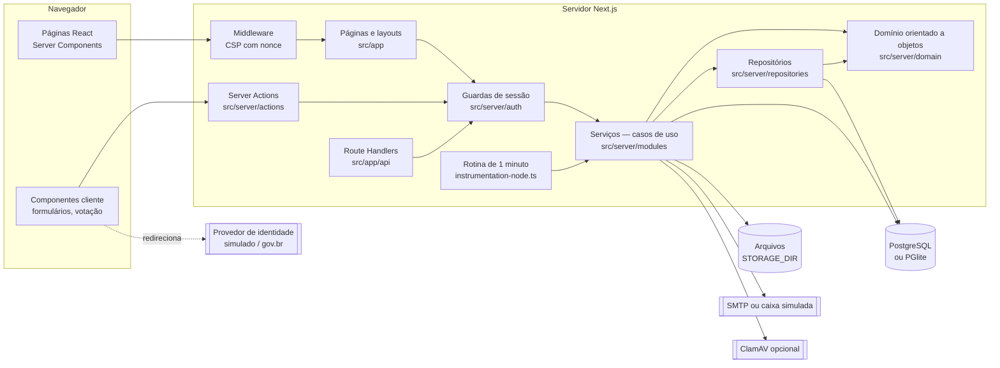
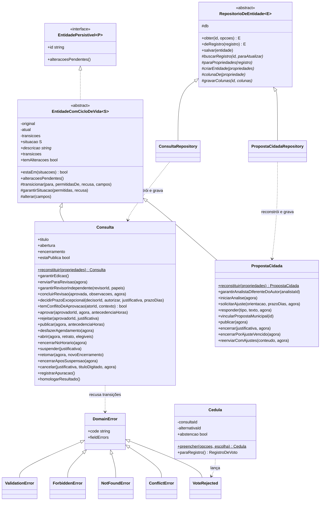
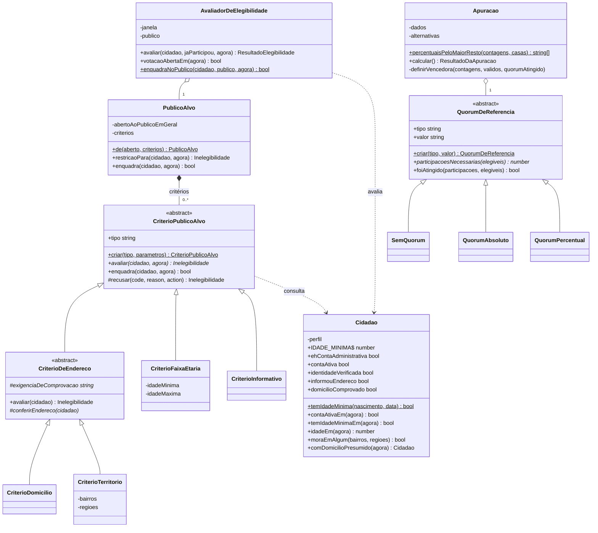
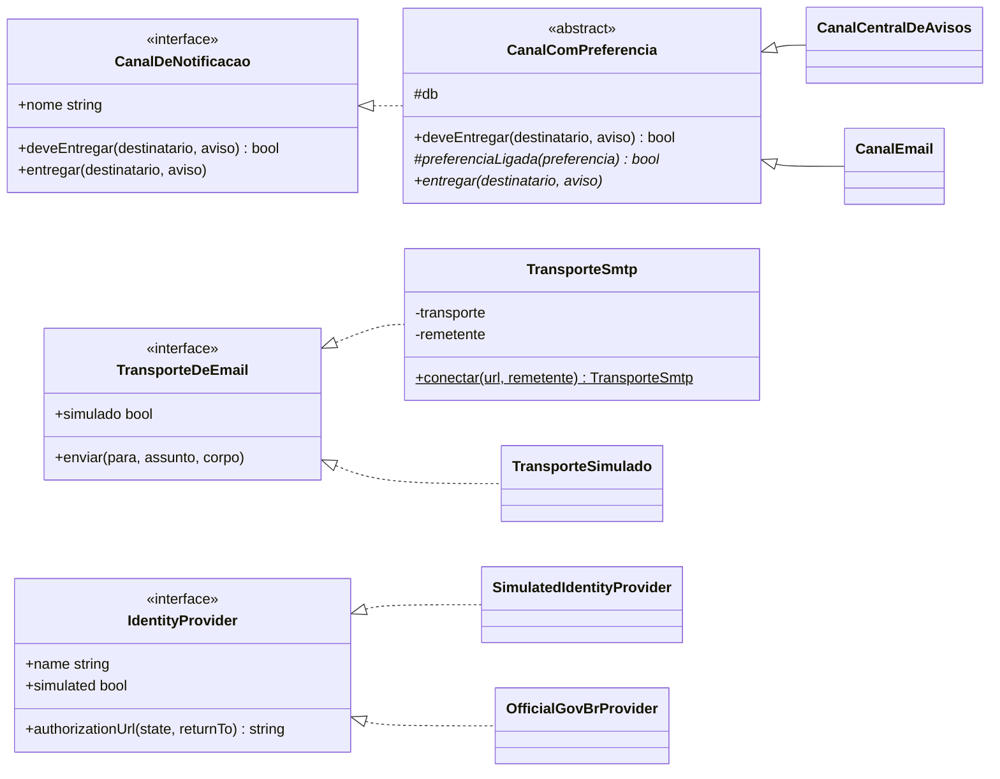
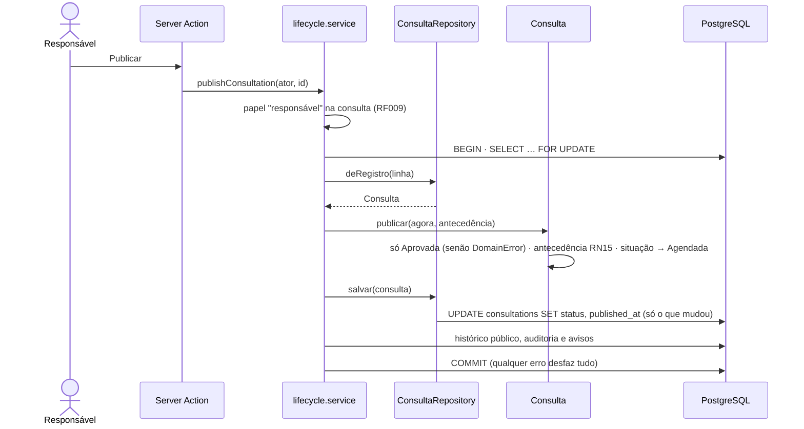
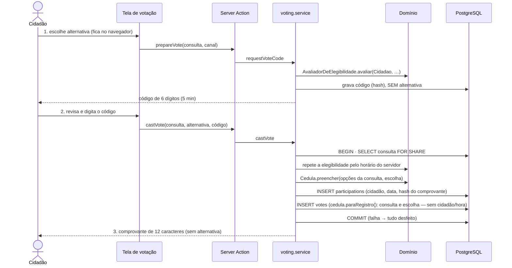

# Arquitetura — PPCM

Monólito Next.js 15 em TypeScript (App Router e Server Actions) com PostgreSQL acessado pelo Drizzle ORM.
O núcleo de regras é orientado a objetos (DT-35): entidades com estado encapsulado, hierarquias de
critérios e estratégias polimórficas, e repositórios que traduzem entre os objetos e as tabelas.

## Visão geral

## Camadas

| Camada | Pasta | Responsabilidade | Pode depender de |
|---|---|---|---|
| Interface | `src/app`, `src/components` | Páginas (Server Components), formulários cliente, layout e acessibilidade. **Não acessa o banco** (regra de lint). | ações, guardas, serviços (leitura) |
| Ações | `src/server/actions` | Recebem `FormData`, chamam o guarda de sessão e o serviço, convertem erros de domínio em mensagens por campo e redirecionam. | guardas, serviços |
| Guardas | `src/server/auth/current.ts` | Sessão atual, `requireCitizen`, `requireAdmin(permissão)`; auditam acessos negados. | serviços de acesso e auditoria |
| Serviços (casos de uso) | `src/server/modules/*` | Coordenam cada operação: validação de entrada (Zod), autorização (permissão + papel na consulta), transação, chamada às entidades, persistência pelos repositórios, auditoria e avisos. | domínio, repositórios, infraestrutura |
| **Domínio** | `src/server/domain` | Entidades, estratégias e serviços de domínio com as regras de negócio. **Não acessa banco, relógio nem interface**: recebe `agora` de quem chama. | apenas utilitários puros (`lib/errors`, `lib/clock` só constantes e `ageOn`, `lib/labels`, `lib/text`) |
| **Repositórios** | `src/server/repositories` | Traduzem entre entidades e tabelas (Drizzle ORM); gravam só o que a entidade mudou. | domínio, `db` |
| Infraestrutura | `src/server/lib`, `src/server/db` | Banco, criptografia, CPF, Argon2id, TOTP, arquivos, CSV/PDF, CAPTCHA, parâmetros, relógio do servidor. | — |
| Compartilhado | `src/lib` | Rótulos, permissões, CPF e texto — seguros para cliente e servidor. | — |

**Comunicação entre camadas.** A página chama uma ação → a ação confere a sessão e chama o serviço → o
serviço abre a transação, carrega a entidade pelo repositório, chama o método de negócio
(`consulta.publicar(...)`), pede ao repositório que grave as alterações, registra a auditoria e os
avisos e confirma. Se a regra recusa, a entidade lança `DomainError` (mensagem em português simples),
a transação é desfeita e a ação devolve a mensagem ao formulário.

### Organização do domínio

| Pasta | Conteúdo |
|---|---|
| `domain/entities/` | `EntidadeComCicloDeVida` (abstrata), `Consulta`, `PropostaCidada`, `Cidadao`, `PublicoAlvo`, `Cedula` |
| `domain/strategies/` | `CriterioPublicoAlvo` e subclasses; `QuorumDeReferencia` e subclasses |
| `domain/services/` | `AvaliadorDeElegibilidade`, `Apuracao` (serviços de domínio puros) |
| `domain/interfaces/` | contratos: `CanalDeNotificacao`, `TransporteDeEmail`, aviso e destinatário, resultado da elegibilidade |
| `domain/erros.ts` | `VoteRejected` |
| `repositories/` | `RepositorioDeEntidade` (abstrata), `ConsultaRepository`, `PropostaCidadaRepository` |
| `modules/notifications/canais.ts` | implementações dos canais (`CanalCentralDeAvisos`, `CanalEmail`) e transportes (`TransporteSmtp`, `TransporteSimulado`), que dependem do banco e do SMTP |

## Integração com PostgreSQL e Drizzle ORM

- **Esquema e migrations:** o modelo é declarado em `src/server/db/schema.ts` (Drizzle) e versionado em `database/migrations` (SQL gerado e revisado). `database/schema.sql` é a estrutura completa num arquivo só, gerada das migrations (`npm run db:sql`); um teste confere que ela reconstrói o mesmo banco.
- **Conexão:** `src/server/db/client.ts` — PostgreSQL real por `DATABASE_URL` (pool do `pg`) ou PGlite (PostgreSQL em WebAssembly) quando a variável está vazia. As migrations são aplicadas ao iniciar (`db/bootstrap.ts`).
- **Leitura e escrita:** os serviços usam o construtor de consultas do Drizzle (consultas parametrizadas, sem SQL concatenado) e transações (`db.transaction`). As entidades com ciclo de vida são lidas e gravadas pelos repositórios; leituras de listagem e relatórios continuam em consultas agrupadas (DT-23).
- **Integridade no banco:** chaves primárias e estrangeiras, `UNIQUE`, `CHECK` de regra de negócio, tipos `ENUM`, gatilhos de registros somente de acréscimo e de `updated_at`, view `vw_consultas_publicas` e contas com permissões (DT-34) — ver `database/README.md`.

## Orientação a objetos (POO)

### Os quatro pilares no núcleo do sistema

| Pilar | Onde | Como |
|---|---|---|
| **Abstração** | `Consulta`, `PropostaCidada`, `Cidadao`, `Cedula`, `PublicoAlvo`, `AvaliadorDeElegibilidade`, `Apuracao`, repositórios | Cada classe representa um conceito do domínio da participação cidadã e expõe só operações com significado de negócio (`publicar()`, `suspender()`, `preencher()`, `avaliar()`, `calcular()`), escondendo como os dados são guardados. |
| **Encapsulamento** | `EntidadeComCicloDeVida` (campos `#original`, `#atual`, `#transicoes`), `Cidadao` (`#perfil`), `Cedula` (`#consultaId`, `#alternativaId`), critérios (`#bairros`, `#regioes`, `#idadeMinima`) | Campos privados do JavaScript (`#`), sem setters. A situação da consulta e da proposta só muda por `transicionar()` (protegido), chamado pelos métodos de negócio, que conferem a situação de origem e aplicam os campos da transição de uma só vez. Tentativa de atribuir `consulta.situacao` lança `TypeError`. |
| **Herança** | `EntidadeComCicloDeVida` → `Consulta`, `PropostaCidada`; `CriterioPublicoAlvo` → `CriterioDeEndereco` → `CriterioDomicilio`, `CriterioTerritorio`; `CriterioPublicoAlvo` → `CriterioFaixaEtaria`, `CriterioInformativo`; `QuorumDeReferencia` → `SemQuorum`, `QuorumAbsoluto`, `QuorumPercentual`; `CanalComPreferencia` → `CanalCentralDeAvisos`, `CanalEmail`; `RepositorioDeEntidade` → `ConsultaRepository`, `PropostaCidadaRepository`; `Error` → `DomainError` → `ValidationError`, `ForbiddenError`, `NotFoundError`, `ConflictError`, `VoteRejected` | A base guarda o comportamento comum (validação de transição e controle de alterações; exigência de domicílio comprovado; regra "obrigatório sempre chega"; fluxo buscar → converter → gravar); cada subclasse só acrescenta o que é dela. |
| **Polimorfismo** | `CriterioPublicoAlvo.avaliar()`, `QuorumDeReferencia.participacoesNecessarias()`/`foiAtingido()`, `CanalDeNotificacao.deveEntregar()`/`entregar()`, `TransporteDeEmail.enviar()`, `EntidadeComCicloDeVida.descricao`, `IdentityProvider.authorizationUrl()` | Quem usa conhece só a abstração: `PublicoAlvo` percorre os critérios sem saber o tipo de cada um (antes, um `switch` em `voting/eligibility.ts`); `Apuracao` pergunta ao quórum sem saber qual foi adotado; `notifyUser` percorre os canais; a fila de e-mails usa o transporte configurado. Métodos-modelo (`CriterioDeEndereco.avaliar`, `RepositorioDeEntidade.salvar`) chamam métodos abstratos sobrescritos nas subclasses. |

### Entidades, persistência e erros

### Elegibilidade e apuração

### Notificações e provedores externos

### Exemplo: publicar uma consulta

## Módulos de serviço (casos de uso)

| Módulo | Arquivo | Classes de domínio usadas | Requisitos |
|---|---|---|---|
| Autenticação e sessões | `auth/auth.service.ts`, `auth/session.service.ts` | `Cidadao.IDADE_MINIMA` (cadastro) | RF001–RF003, RF005–RF008, RF010, RF046 (convite) |
| Controle de acesso | `access/access.service.ts` | — | RF009, RF047, RF061 |
| Identidade | `identity/identity.service.ts` | `IdentityProvider` | RF004 |
| Perfil e direitos do titular de dados | `profile/profile.service.ts` | elegibilidade (resumo) | RF012, RF013, RF015 |
| Consultas — ciclo de vida | `consultations/lifecycle.service.ts` | `Consulta`, `ConsultaRepository` | RF024–RF030, RF032–RF034, RF061 |
| Consultas — leitura | `consultations/queries.service.ts` | `AvaliadorDeElegibilidade` (indicação ao cidadão) | RF016–RF018, RF050, RF056 |
| Votação | `voting/eligibility.ts`, `voting/voting.service.ts` | `Cidadao`, `PublicoAlvo`, critérios, `AvaliadorDeElegibilidade`, `Cedula` | RF011, RF036–RF041 |
| Resultados | `results/tally.ts`, `results/results.service.ts`, `results/open-data.service.ts` | `Apuracao`, `QuorumDeReferencia`, `Consulta` | RF042–RF045, RF059 |
| Rotina automática | `scheduler/scheduler.service.ts` | `Consulta`, `PropostaCidada` | RF019, RF031, RF035, RF055 |
| Propostas | `proposals/*.ts` | `PropostaCidada`, `PropostaCidadaRepository` | RF020–RF022, RF067 |
| Encaminhamentos | `outcomes/outcomes.service.ts` | — | RF063 |
| Anexos | `attachments/attachments.service.ts` | — | RF023 |
| Notificações | `notifications/*.ts` | `CanalDeNotificacao`, `TransporteDeEmail` | RF052–RF055 |
| Auditoria | `audit/audit.service.ts` | — | RF057, RF058 |
| Incidentes | `integrity/incidents.service.ts` | — | RF060 |
| Divulgação | `dissemination/dissemination.service.ts` | — | RF062 |
| Moderação | `moderation/moderation.service.ts` | — | RF064–RF066 |
| Administração | `admin/users.service.ts`, `admin/monitoring.service.ts` | — | RF046–RF049, RNF12 |
| Eventos | `events/events.service.ts` | — | RF068 |

## Fluxo do voto (RF036–RF038)

## Rotina automática (RF019)

A cada minuto (`src/instrumentation-node.ts`): abre consultas agendadas no horário (`Consulta.abrir`, com retrato dos parâmetros), encerra as abertas no horário (`Consulta.encerrarNoHorario`; o `UPDATE` aguarda votos em andamento), verifica integridade e apura (`Consulta.registrarApuracao`), envia lembretes 48 h antes, encerra propostas sem ajuste no prazo (`PropostaCidada.encerrarPorAjusteVencido`), remove cópias de dados pessoais expiradas (RF015), reordena fisicamente os votos e processa a fila de e-mails pelo `TransporteDeEmail` configurado. Pode ser executada manualmente em `/admin/monitoramento` ou com `npm run jobs:tick`.

## Segurança transversal

- CSP com nonce, `X-Frame-Options: DENY`, `nosniff`, `Referrer-Policy`, `Permissions-Policy`, HSTS em produção (`next.config.ts`, `src/middleware.ts`).
- Autorização no servidor em toda página, ação e rota; papéis por consulta para atos do ciclo de vida. A segregação de funções (RN20, RN36) também está na entidade `Consulta` (`temConflitoDeAprovacao`, `garantirRevisorIndependente`).
- Toda escrita administrativa ocorre em transação com auditoria encadeada; se a auditoria falhar, o ato é desfeito.
- Sigilo do voto por construção: a `Cedula` não tem campo para o eleitor; `votes` não tem chave para cidadão, participação ou horário (RN07).
- Nenhum dado pessoal em páginas públicas, exportações ou auditoria (filtro de campos proibidos em `audit.service.ts`).

## Implantação

- `Dockerfile` (build standalone) e `docker-compose.yml` (PostgreSQL 16 + aplicação). Variáveis em `.env.example`.
- Produção: definir `DATABASE_URL`, `CPF_HMAC_KEY`, `DATA_ENCRYPTION_KEY`, `APP_SIGNING_KEY`, `APP_URL` com https, `DEMO_MODE=false`, `SMTP_URL` e, se possível, `CLAMAV_HOST`.
- Banco a partir de um arquivo: `database/schema.sql` + `database/seed-referencia.sql` (ver `database/README.md`).
- Backups: `pg_dump` diário com teste periódico de restauração (RNF14) — ver `docs/arquitetura/MODELO_DE_DADOS.md`.
