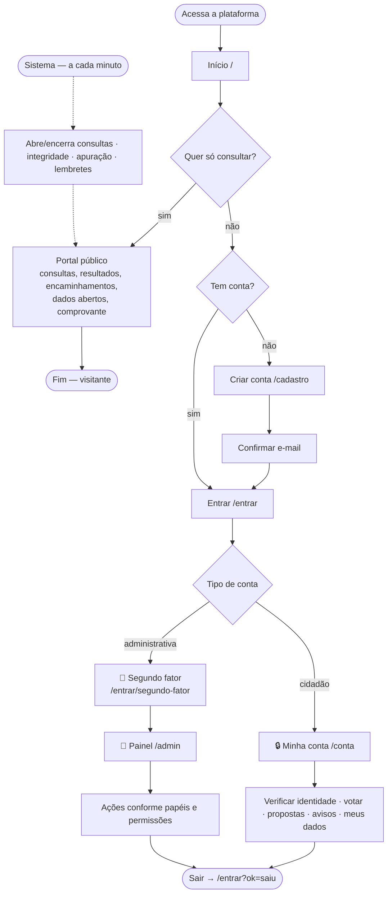
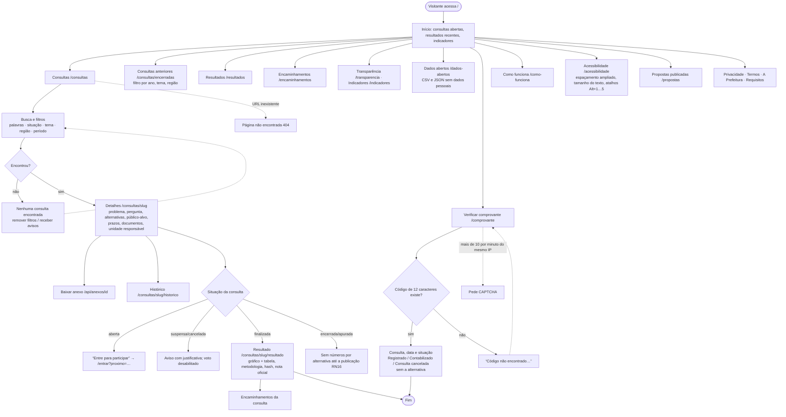
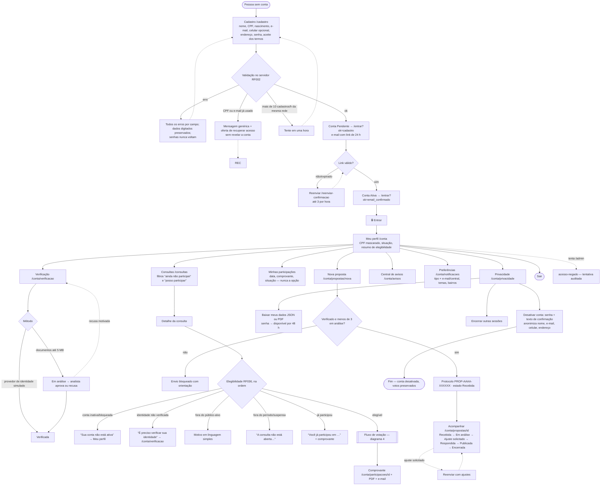
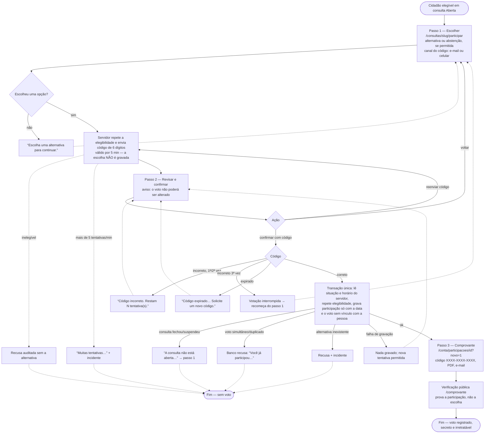
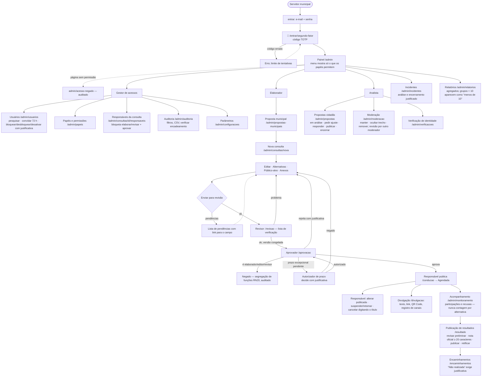
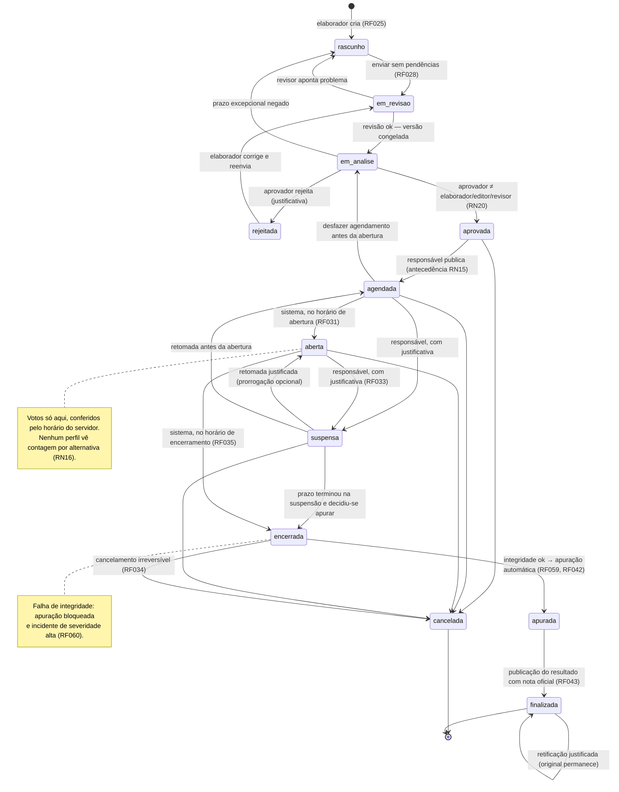
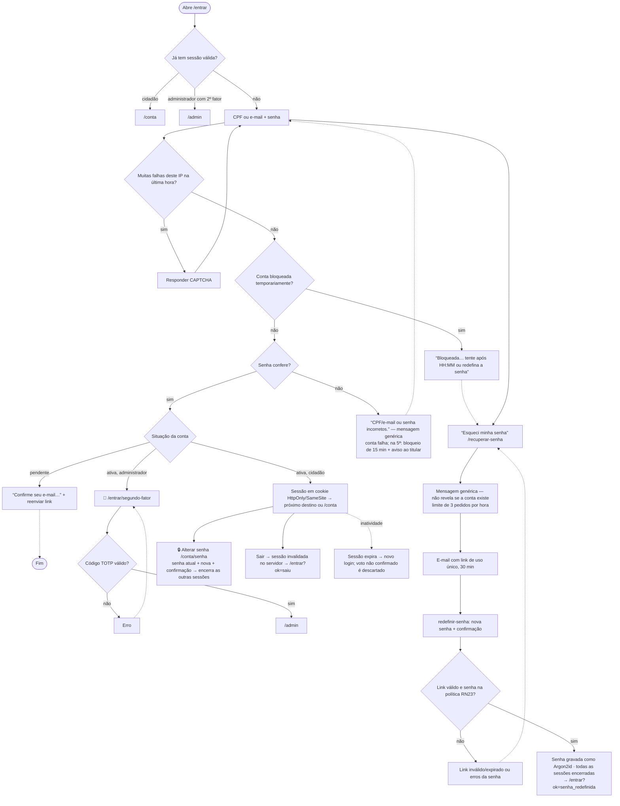

# Fluxos de utilização (User Flow) — PPCM

Mapeamento dos caminhos que cada perfil percorre na Plataforma de Participação Cidadã Municipal, levantado
**no código** (`src/app`, `src/server/actions`, `src/server/modules`) e conferido no navegador em 24/11/2026
com o build de produção e os dados fictícios de demonstração (568 páginas visitadas por 7 perfis — ver
`docs/testes/RELATORIO_DE_TESTES.md`). Os identificadores (RFxxx, RNxx) são os do Documento de Requisitos v6.

Convenções dos diagramas: retângulo arredondado = início/fim; retângulo = tela ou ação; losango = decisão;
🔒 = exige autenticação; 🔐 = exige segundo fator (conta administrativa); setas tracejadas = caminho alternativo
ou de erro. Os caminhos de URL são os reais.

## Perfis e permissões

| Perfil | Como entra | O que pode | O que não pode |
|---|---|---|---|
| Visitante | sem login | portal público: consultas, detalhes, histórico, resultados publicados, encaminhamentos, propostas publicadas, indicadores, dados abertos, verificação de comprovante, páginas institucionais | votar, enviar propostas, acessar `/conta` ou `/admin` (redireciona para `/entrar?proximo=…`) |
| Cidadão | CPF ou e-mail + senha (`/entrar`) | perfil, verificação de identidade, votar (se elegível), comprovantes, propostas, avisos, preferências, cópia dos dados, desativação | acessar `/admin` (vai para `/acesso-negado`, tentativa auditada); ver a opção em que votou |
| Administrador | e-mail + senha + código TOTP (`/entrar/segundo-fator`) | o que os papéis permitem — gestor de acessos, elaborador, revisor, aprovador, autorizador de prazo, responsável, divulgação, acompanhamento, publicação de resultados, encaminhamentos, análise de propostas, moderação, atendimento | votar (RN22); aprovar consulta que elaborou, editou ou revisou (RN20, RN36); ver contagem por alternativa durante a votação (RN16); alterar votos (RN39) |
| Sistema | rotina a cada minuto (`scheduler.service.ts`) | abrir e encerrar consultas no horário, verificar integridade, apurar, lembretes de 48 h, encerrar propostas sem ajuste | — |

Contas fictícias: senha `Demo@2026`; cidadãos `maria@exemplo.com` (verificada), `joao@exemplo.com` (não verificado),
`carla@exemplo.com`; administradores `gestor@`, `elaboradora@`, `revisor@`, `aprovadora@`, `autorizador@`,
`responsavel@`, `analista@prefeitura.exemplo` (códigos TOTP em `/demo`).

---

## 1. Fluxo geral do sistema

## 2. Fluxo do visitante (portal público, sem autenticação)

## 3. Fluxo completo do cidadão

## 4. Fluxo de votação (RF011, RF036–RF041)

## 5. Fluxo administrativo (por papel)

## 6. Ciclo de vida de uma consulta pública (RF019, RF024–RF035, RF042–RF043)

Situações visíveis no portal: Agendada, Aberta, Suspensa, Encerrada, Apurada ("Votos contados — resultado em
conferência"), Finalizada ("Resultado publicado") e Cancelada. Rascunho, Em revisão, Em análise, Aprovada e
Rejeitada nunca aparecem ao público (RF016).

## 7. Autenticação e recuperação de senha (RF003, RF005–RF008, RF010)

## Caminhos alternativos verificados na revisão de 24/11/2026

| Situação | Comportamento observado |
|---|---|
| Visitante abre `/conta`, `/admin` ou `/consultas/slug/participar` | redireciona para `/entrar?proximo=…` |
| Cidadão abre `/admin` | `/acesso-negado`, tentativa registrada na auditoria |
| Administrador sem a permissão da página | `/admin/acesso-negado`, tentativa registrada |
| Cidadão abre proposta ou comprovante de outra pessoa | 404 (o recurso “não existe” para ele) |
| Endereço com identificador fora do formato (`/conta/propostas/abc`) | 404 — **antes da revisão: erro 500** |
| Filtro de URL manipulado (`/consultas?tema=abc`, `?de=xyz`) | página normal sem resultados / filtro ignorado — **antes: erro 500** |
| Cidadão já votou e abre `/participar` | redireciona ao comprovante |
| Consulta encerrada, suspensa ou cancelada | botão de participar desabilitado com o motivo; servidor recusa o voto |
